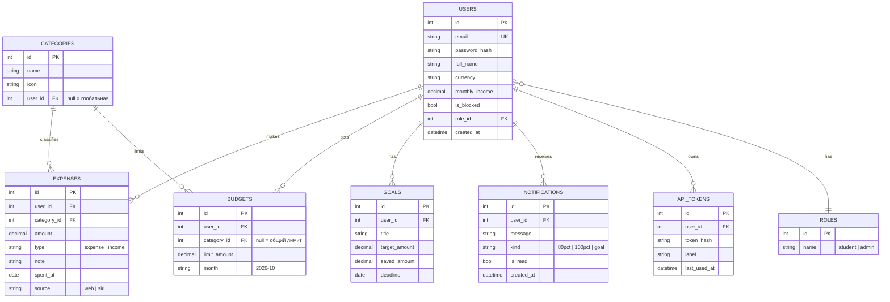

# StudentWallet — пакет документов проекта

Учёт расходов студента: анализ трат и бюджет на месяц, с быстрым вводом через Siri/Shortcuts.

---

## 1. Project Proposal

**Проблема.** Студенты тратят деньги спонтанно (еда, транспорт, подписки, развлечения) и к концу месяца не понимают, куда ушла стипендия или деньги от родителей. Банковские приложения показывают операции, но не помогают держаться в лимите.

**Цель.** Создать систему, которая позволяет быстро записывать траты, задавать месячный бюджет по категориям, видеть аналитику и получать предупреждения при приближении к лимиту.

**Задачи (измеримые):**
- добавление траты не дольше 10 секунд (в вебе или голосом через Siri);
- бюджет по категориям с предупреждением на 80% и 100%;
- дашборд с графиками за неделю/месяц;
- хранение данных на сервере, доступ с веба и с iPhone.

**Целевые пользователи:** студенты вузов и колледжей (основная роль), администратор системы.

**Scope (входит):** веб-приложение, REST API, база данных, интеграция с Siri/Shortcuts через API, аналитика, бюджеты, цели накопления.

**Out of scope:** автоматическое чтение транзакций из банка (у казахстанских банков нет публичных API для физлиц), реальные платежи, публикация в App Store.

**Технологический стек (предложение):**

| Слой | Технология |
|---|---|
| Frontend | React + Vite (или Next.js), Chart.js для графиков |
| Backend | Python FastAPI (или Node.js + Express) |
| БД | PostgreSQL (для разработки можно SQLite) |
| Auth | JWT + хеширование паролей (bcrypt) |
| iOS/Siri | Apple Shortcuts, вызывает ваш REST API (Swift не обязателен) |
| Тесты | pytest / Jest, Postman-коллекция |
| Версии | GitHub, ветки по спринтам |

---

## 2. Функциональность (10 фич)

1. Регистрация и вход (JWT)
2. Профиль студента (валюта, месячный доход, настройки уведомлений)
3. Учёт расходов и доходов (CRUD)
4. Категории трат (стандартные + свои)
5. Месячный бюджет по категориям и общий лимит
6. Предупреждения о лимите (80% / 100%, «осталось X ₸ на N дней»)
7. Дашборд аналитики (графики по категориям, динамика, сравнение месяцев)
8. Цели накопления (например, «ноутбук 400 000 ₸»)
9. Быстрый ввод через Siri/Shortcuts (API-токен для Shortcuts)
10. Панель администратора (пользователи, общие категории, статистика)

**Роли:**
- **Student** — всё, что связано со своими данными;
- **Admin** — управление пользователями, глобальными категориями, просмотр обезличенной статистики.

---

## 3. Требования

### Функциональные

| ID | Требование |
|---|---|
| FR-1 | Пользователь может зарегистрироваться и войти по email и паролю |
| FR-2 | Пользователь может создавать, просматривать, редактировать, удалять траты и доходы |
| FR-3 | Трата содержит сумму, категорию, дату, комментарий |
| FR-4 | Пользователь задаёт месячный бюджет (общий и по категориям) |
| FR-5 | Система показывает остаток бюджета и дневной лимит |
| FR-6 | Система создаёт уведомление при достижении 80% и 100% бюджета |
| FR-7 | Дашборд показывает траты по категориям и по дням |
| FR-8 | Пользователь создаёт цели накопления и пополняет их |
| FR-9 | Пользователь генерирует API-токен для Shortcuts и добавляет трату голосом |
| FR-10 | Админ управляет пользователями (блокировка) и глобальными категориями |

### Нефункциональные

| Тип | Требование |
|---|---|
| Usability | Добавление траты не более 3 действий; интерфейс адаптивный (телефон/ПК) |
| Performance | Ответ API на типовой запрос до 500 мс; дашборд грузится до 2 с |
| Security | Хеширование паролей, JWT с истечением, проверка ролей на сервере, валидация входных данных, защита от SQL-инъекций (ORM), HTTPS |
| Reliability | Единый формат ошибок API, обработка ошибок на UI, регулярные бэкапы БД |
| Maintainability | Разделение на слои (routes / services / models), README, комментарии к API (Swagger/OpenAPI) |

---

## 4. Product Backlog и User Stories

Оценка в story points (SP): 1 = очень просто, 2 = просто, 3 = средне, 5 = сложно, 8 = очень сложно.
Приоритет: **H** высокий, **M** средний, **L** низкий.

| ID | User story | Роль | SP | Приор. | Спринт |
|---|---|---|---|---|---|
| US-1 | Как студент, я хочу зарегистрироваться, чтобы вести свои траты | Student | 3 | H | 1 |
| US-2 | Как студент, я хочу войти и выйти из системы | Student | 2 | H | 1 |
| US-3 | Как пользователь, я хочу, чтобы мои данные были закрыты от других | Все | 3 | H | 2 |
| US-4 | Как студент, я хочу добавить трату (сумма, категория, дата) | Student | 3 | H | 2 |
| US-5 | Как студент, я хочу редактировать и удалять траты | Student | 2 | H | 2 |
| US-6 | Как студент, я хочу видеть список трат с фильтром по дате и категории | Student | 3 | H | 3 |
| US-7 | Как студент, я хочу управлять своими категориями | Student | 2 | M | 3 |
| US-8 | Как студент, я хочу задать месячный бюджет | Student | 3 | H | 3 |
| US-9 | Как студент, я хочу видеть остаток бюджета и дневной лимит | Student | 3 | H | 4 |
| US-10 | Как студент, я хочу получать предупреждение при 80% и 100% лимита | Student | 5 | H | 4 |
| US-11 | Как студент, я хочу видеть графики трат по категориям и дням | Student | 5 | H | 4 |
| US-12 | Как студент, я хочу фиксировать доходы (стипендия, переводы) | Student | 2 | M | 4 |
| US-13 | Как студент, я хочу ставить цели накопления | Student | 3 | M | 5 |
| US-14 | Как студент, я хочу получить API-токен для Shortcuts | Student | 3 | H | 5 |
| US-15 | Как студент, я хочу сказать Siri «добавь 1500 на обед» и увидеть трату в приложении | Student | 5 | H | 5 |
| US-16 | Как студент, я хочу видеть остаток лимита после оплаты (Shortcuts-автоматизация) | Student | 3 | M | 6 |
| US-17 | Как админ, я хочу видеть список пользователей и блокировать их | Admin | 3 | M | 6 |
| US-18 | Как админ, я хочу управлять глобальными категориями | Admin | 2 | L | 6 |
| US-19 | Как админ, я хочу видеть общую статистику (число пользователей, трат) | Admin | 3 | L | 6 |
| US-20 | Как студент, я хочу экспортировать траты в CSV | Student | 2 | L | 6 |
| US-21 | Как команда, мы хотим покрыть ключевую логику тестами и исправить баги | Команда | 8 | H | 7 |

Итого 68 SP. На 7 спринтов выходит примерно по 10 SP: это комфортная нагрузка. Если успеваете быстрее, берите US-20 и расширения.

---

## 5. Архитектура

```
Web UI (React)          iPhone: Siri + Shortcuts
        \                      /
         \                    /
          REST API (FastAPI) — JWT / API-токен
                   |
            Business Logic
       (бюджеты, лимиты, аналитика)
                   |
              PostgreSQL
```

Монолитный backend, как разрешено в требованиях курса.

### Как работает Siri без Swift
1. В приложении пользователь нажимает «Создать токен для Shortcuts».
2. В приложении «Команды» на iPhone создаётся команда «Добавить трату»:
   - действие «Запросить ввод» (сумма) и «Выбрать из меню» (категория);
   - действие «Получить содержимое URL»: `POST https://ваш-сервер/api/expenses` с заголовком `Authorization: Bearer <токен>`;
   - действие «Показать уведомление» с ответом сервера («Осталось 12 400 ₸ из 60 000 ₸»).
3. Имя команды становится голосовой фразой: «Привет, Siri, добавь трату».
4. Для показа лимита при оплате: Команды → Автоматизация → создать → триггер «Транзакция» (срабатывает при оплате картой из Wallet; зависит от доступности вашей карты в Apple Wallet) → действие «Получить содержимое URL» на `GET /api/budget/summary` → «Показать уведомление».
5. Если триггер «Транзакция» недоступен, запасной вариант: запуск команды через Back Tap (двойное касание задней панели) или иконку на экране.

На защите покажите это вживую: голос → трата появляется на дашборде.

### Модель данных (ER-диаграмма, 8 таблиц)



### Основные эндпоинты API

| Метод | Путь | Описание |
|---|---|---|
| POST | /api/auth/register, /api/auth/login | Регистрация и вход |
| GET/POST | /api/expenses | Список (с фильтрами) и создание |
| PUT/DELETE | /api/expenses/{id} | Изменение и удаление |
| GET/POST | /api/categories | Категории |
| GET/PUT | /api/budgets?month=2026-10 | Бюджеты месяца |
| GET | /api/budget/summary | Остаток, дневной лимит, % использования |
| GET | /api/analytics/by-category, /by-day | Данные для графиков |
| GET/POST | /api/goals | Цели |
| GET | /api/notifications | Уведомления |
| POST | /api/tokens | Создать токен для Shortcuts |
| GET | /api/admin/users, PATCH /api/admin/users/{id} | Только для admin |

---

## 6. План спринтов (7 спринтов)

Длительность спринта подберите под свой семестр (обычно 1–2 недели).

| Спринт | Цель | Задачи | Deliverable курса |
|---|---|---|---|
| 1 | Основа | Репозиторий, структура проекта, БД и миграции, регистрация/вход (US-1, US-2), wireframes | Sprint 1–2: базовая система + auth + БД |
| 2 | Безопасность и первый CRUD | Роли и защита маршрутов (US-3), CRUD трат (US-4, US-5) | Sprint 1–2 |
| 3 | Ядро | Список с фильтрами (US-6), категории (US-7), бюджеты (US-8) | Sprint 3–4: core functionality |
| 4 | Аналитика | Остаток и дневной лимит (US-9), уведомления (US-10), графики (US-11), доходы (US-12) | Sprint 3–4 |
| 5 | Siri и цели | Цели (US-13), API-токены (US-14), команда Shortcuts (US-15) | Sprint 5–6: advanced/integration |
| 6 | Админка и автоматизация | Лимит при оплате (US-16), админ-панель (US-17–19), экспорт (US-20) | Sprint 5–6 |
| 7 | Финализация | Тесты, баги, безопасность, деплой, документация, репетиция демо (US-21) | Sprint 7 |

**Ритуалы в каждом спринте:** Sprint Planning (выбираем истории), еженедельный stand-up (15 мин), Sprint Review/Demo (показываем работающее), Retrospective (что улучшить), обновление Burndown (Jira, Trello, GitHub Projects или таблица Google Sheets с остатком SP по дням).

---

## 7. Тестирование

- **Unit-тесты:** расчёт остатка бюджета, процента использования, дневного лимита, создание уведомлений.
- **API-тесты:** регистрация, логин, CRUD трат, запрет доступа к чужим данным (проверка на 403), доступ к /admin только для admin.
- **Ручные тест-кейсы:** таблица «шаг / ожидаемый результат / факт» для основных сценариев UI.
- **Интеграционный тест Siri:** вызов команды → трата появилась в БД с `source = siri`.
- **Нагрузка (минимум):** 100 запросов подряд к /api/expenses, замер времени ответа.

---

## 8. Риски

| Риск | Что делать |
|---|---|
| Нет Mac / нет опыта Swift | Используем Shortcuts вместо нативного приложения; Mac не нужен |
| Триггер оплаты в Wallet не работает с вашей картой | Запасные варианты: Back Tap, иконка команды, виджет |
| Не успеваем по срокам | Приоритеты H в первую очередь; L (экспорт, админ-статистика) режем без потерь |
| Серверу нужен публичный адрес для Shortcuts | Деплой на Render / Railway / Fly.io (есть бесплатные тарифы) или временный туннель ngrok для демо |
| Конфликты в git | Ветки `feature/...`, pull request с ревью второго участника |

---

## 9. Структура финальной документации

1. Введение, цели, scope
2. Требования (FR/NFR) и user stories
3. Product Backlog и оценки
4. UI/UX: wireframes и макеты
5. Архитектура, ER-диаграмма, описание API
6. Реализация (ключевые решения, интеграция с Siri)
7. Тестирование (план, результаты, найденные баги)
8. Отчёты по спринтам (planning, review, retro, burndown)
9. Руководство пользователя (с скриншотами)
10. Выводы и дальнейшее развитие
